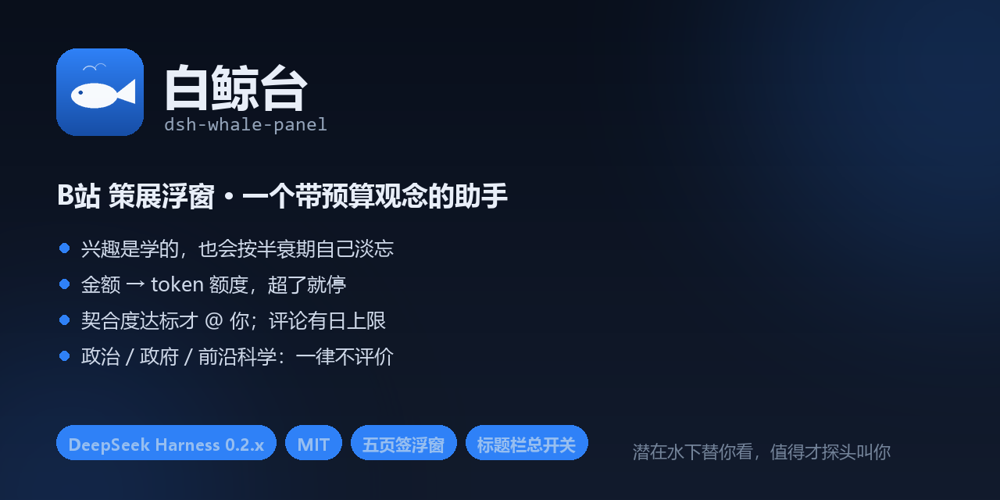

# 白鲸台 · dsh-whale-panel




> **一个带预算观念的 B站 策展助手**：按概率认识你，按半衰期遗忘，按峰谷算钱，
> 只在你划定的额度内替你挑内容。
>
> **它不替你经营账号**：不刷播放量、不自动点赞投币、不发正文以外的社交动作。
> **它不和你的账号抢**：用的是**单独的发言号**（扫码登录的那个），你本号照常刷 B站，
> 两边同时用不会互踢、不会触发异地校验；它看过的片子会在本机台账里标成 `source: plugin`，
> 记录页一眼能看出「哪条是它看的」。
> **它不越界发言**：政治 / 政府政策 / 前沿科学三类话题，写死三层闸门，一律不评价。

当前版本：**1.26.1** · 许可证：MIT · 宿主：DeepSeek Harness 0.2.x

**三句话看懂它：**

- 兴趣是**学的**，而且会**衰减**——不用你维护关键词，旧兴趣自己淡出。
- 花的是 **token 额度**，不是「次数」——金额只是上限，时段决定汇率。
- 评论默认**关**；开了也是「起草→你确认」，且有硬禁区三层拦截。

**它不干什么（这几条比功能列表更该先看）：**

| 它不做 | 为什么 |
| --- | --- |
| 不刷播放量、不自动点赞投币 | 这些是不可逆的社交痕迹，不该替你做 |
| 不替你经营账号 | 定位是「潜在水下替你看，值得才探头叫主人」，不是「替你涨粉」 |
| 不承诺站外什么都能播 | 受 UP 主嵌入开关与防盗链限制，这里只保证**状态可观测** |
| 不评价政治 / 政府 / 前沿科学 | 三层闸门写死在代码里（见「评论条例」一节） |

## 截图（欢迎 PR）

> 📷 我这边不方便录屏，所以先留位：`docs/screenshots/` 已开好，**欢迎社区提交截图 / 录屏**。
> 想看的样子：学习页画像的字号变化、运行页的「金额 → token」实时换算、
> 监测台事件流、标题栏总开关拨到「已关闭」、记录页「它看过的 N 条」。

<!-- 待补充：learn.png · run.png · monitor.gif · power-off.png -->

怎么截、遮哪些隐私、命名规则见 [`docs/screenshots/README.md`](docs/screenshots/README.md)。
**截图请务必打码 UID / 昵称 / 二维码**——那是账号，不是演示素材。

> 📖 面向使用者的完整说明（安装、五个页签、五个公式、接口清单、已知边界、B站 接口实测）
> 见 [`docs/使用手册.md`](docs/使用手册.md)；开发踩坑见 [`docs/dev-notes.md`](docs/dev-notes.md)。
> 本文件偏工程。

---

## 和你的账号是什么关系

这是装之前最该问清楚的，先说结论：**插件和你本人不抢同一个会话**。

- **两个号分工**：插件全程用**发言号**（就是你扫码登录的那个）去听、去看、去评论；
  **主人号**只被 @ 提醒，插件不会拿它做任何写操作。
- **不互踢**：登录拿的是普通 cookie（`SESSDATA` / `bili_jct`），不是设备级独占会话。
  你用发言号同时刷 B站 也不会被踢下线，插件也不会因为你在看而任务失败。
- **请求走真实 session**：选片、看片、上报都是这个账号的正常请求特征，不是高频接口扫射；
  而且插件自己还有「一轮跑完隔 N 秒」的节奏限制。
- **⚠️ 诚实说清代价**：插件看过的片子**会进发言号的观看历史**（这是 `history/report` 的结果，
  好处是「看过的不会再推给你」）。B站 服务端的历史我们改不了、也不会去改；
  但插件在本机记了一份台账（`watchLog`，`source: plugin`），
  **「记录」页第一条就是「它看过的 N 条」**，随时能对上账。
- **不同账号时**：你要是拿另一个号登录发言，插件就跟着换，不会串号；状态文件里 cookie 只存当前这一份。

---

## 一、它解决什么

| 你的痛点 | 它的做法 |
| --- | --- |
| 想看点什么，但不想每天自己刷 | 每轮运行按兴趣词去搜 + 混入热门，去重后给你 10–20 条 |
| 关键词是死配置，写一次就过时 | 兴趣画像是**学的**，而且**会衰减**：旧的自动淡出，新的顶上来 |
| 不想一直手动点“开始学习” | 每次运行按概率自己决定学不学（概率你定，默认 35%） |
| 想让它在评论区接话，但怕号废 | 评论区默认关；开启后是“起草→你确认”或“自检→少量自主”，有日上限 |
| 怕它偷偷烧钱 | 日上限 + 单次上限两级，超了直接拦；进度条常驻底栏 |
| 用久了没人告诉你它还缺什么 | 留言区会自己攒“我觉得还能加什么”，等你采纳/驳回 |

---

## 二、安装与打开

```powershell
# 在 DSH 会话里让它装（推荐）
plugin_manager install_bundle D:\plugins\dsh-whale-panel
```

装好后**刷新页面**，右下角出现圆形「鲸」按钮，点开就是浮窗；拖标题栏可移动，位置和页签会记住。

- 收起后是那个圆按钮，不占版面
- 标题栏从左到右：Logo、标题、登录状态、「N 条待回」、主题切换、收起

---

## 三、五个页签

### 1）学习

- **主人号 UID**：只填数字，不需要登录。旁边「查」会拉一次用户卡片确认是谁
- **手动话题**：逗号分隔，权重最高（每个 +6），是你直接下命令的那条线
- **补充视频链接**：粘 BV 号或链接，最多 20 个，自动解析标题和标签
- **每轮自动去学的概率**：0–100%，默认 35%。运行时才触发，不需要手动点
- **兴趣画像**：词的大小和透明度按权重走，越重要越大越实；悬停看得见权重和“最近一次出现”
- **旧兴趣淡出的半衰期**：默认 7 天，0.5–60 可调；权重掉到地板 1 以下自动删除
- **评论区语气 · 实时**：每轮运行自动读两条视频的评论区，算平均字数、表情率、高频词

### 2）运行

- **平台**：B站已接入；小红书/抖音是占位（选了会明说未接入，不会假装干活）
- **发言号**：扫码登录，只用于后续写操作；登录态存本地文件
- **峰谷模式**：自动判断北京时间是否在 00:30–08:30 谷时。谷时按折扣单价折算，同样的钱能换到更多 token，于是每轮目标条数自动变多；关掉就按原价算
- **预算**：输入的是金额，但真正分配的是 token——日上限、单次上限都实时换算成 token 额度显示，已用多少也按 token 记
- **每轮目标条数 / 最多续接次数**：目标没跑够会挂起，下次先补缺口；续接到上限就放弃重开
- **评论区**：滑动开关；开后有档位——自动发 / 起草后我确认 / 自检 → 少量自主（可设每天 N 条）
- **草稿由模型拟**：结合视频标题/简介/UP、兴趣画像、评论区语气统计生成一条完整评论，模型不可用时回退模板；发送前可在文本框改
- **@ 主人号概率**：默认 50%，只对“兴趣”来源的条目逐条掷骰子
- **刷一轮并挑推荐**：主按钮；结果列表点标题会跳到监测台的「预览」

### 3）监测

- **干了什么**：宿主事件流，每秒拉一次，带时间戳，按 info/ok/err 着色
- **预览**：封面 + 标题 + UP + 时长 + 播放量（公开接口），一个「在 B站打开」按钮
- **试播**：默认不加载 iframe；点「试播（可能受限）」才挂官方播放器，6 秒后给出受限提示
- 开关关掉就不发请求、不占资源；画面与事件流互不影响

> 站外能否播放由 UP 主开关与防盗链决定。这里不承诺“什么都能播”，只保证状态可观测。

### 4）留言

- 顶部输入框可以直接留言（Enter 或点「留」）
- 每条留言有 **采纳 / 先不用 / ×**，下面一行「我的想法…」失焦即存
- 系统会自己往里追加建议（跑满 3 轮提定时、读到评论提语气、画像有了提纠偏）

---

## 四、核心机制

### 4.1 兴趣画像怎么长出来

四条线并行，互不阻塞，各自失败不影响其它：

| 线 | 来源 | 依赖 |
| --- | --- | --- |
| A 关注动态 | `feed/all` 里主人的投稿 | 发言号登录且已关注主人号 |
| B 公开投稿 | `space/wbi/arc/search`（WBI 签名） | 无，但常被 -799/-352 限频 |
| C 手动话题 | 你自己写的词 | 无 |
| D 手动链接 | 你粘的 BV 号 → `view` + `tag/archive/tags` | 无 |

样本补完标签后加权：标签 ×3、标题分词 ×1、手动话题 ×6。

### 4.2 衰减公式

```
旧权重' = 旧权重 × 0.5 ^ (距上次出现的天数 / 半衰期)
新画像  = 旧权重' 与本次观察相加，低于地板（默认 1）的丢弃，按权重取前 14
```

所以“最近一直在看什么”会迅速占满前列，三个月前的那点兴趣会自然消失，不需要谁去手动清理。

### 4.3 @ 提醒（单独成条）

正文评论里**不带 @**。正文发出之后，再按 `mentionChance` 掷一次骰子，命中就**另发一条**只表达“想让你看看这个”的短评论（约 10 秒后发，避免同账号连发），并带上 `at_name` 让被 @ 的人真的收到通知。

两条评论在「记录」页分开打标：@ 提醒带 `@ 提醒` 标记，接回复流程只处理正文评论下的回复。
额度不够时只发正文、不硬发提醒。

### 4.4 预算 → token 换算

金额只是上限，真正分配的是 token：

```
混合单价 = 输入价 × 0.3 + 输出价 × 0.7        （¥/百万 token）
有效单价 = 混合单价 × (峰谷模式开启且处于谷时 ? 折扣 : 1)
日额度   = 日上限 ÷ 有效单价
单次额度 = 单次上限 ÷ 有效单价
每轮目标 = min(目标条数, 单次额度 ÷ 每条估算 tokens)
```

默认值：输入 ¥2/百万、输出 ¥8/百万、谷时折扣 0.5、每条推荐估算 1200 tokens。
这些都可在 `state.json` 里调，属于**估算模型**，不是真实账单。

日上限不要求跑满，剩下的不结转也不浪费；只有累计用量碰到天花板才会拦。

### 4.5 续接

一轮没跑够目标条数时，把缺口记进 `pending`（含已续接次数）。
下次运行先补这个缺口，最多续接 `maxResume` 次（默认 2）；到顶就丢弃缺口、重新开始，
避免为了补齐几条而无限来回消耗。

### 4.6 连播与自愈

「连播」打开后，一趟跑完只隔 `cruiseGapSec`（默认 45 秒）就自己开下一趟，不再整小时空等；
运行页和监测台都会显示“下一条 N 秒后开跑”。

防卡死五件套：

1. **运行锁**：进程内锁 + `runningSince` 落盘，上一轮没跑完时新触发直接返回，不会再叠加两轮。
2. **看门狗**：`runningSince` 超过 6 分钟没清，判定卡死并自动回收重来。
3. **收尾兜底**：`run` 在 `finally` 里清锁、写 `nextRunAt`，并把停在「选片中/连播中」的阶段强行拉回「空闲」。
4. **超时**：自请求 180 秒、所有 B站 接口 15 秒，网络挂起不会再把整轮无限期拖住。
5. **额度/未登录**：token 额度用完只把下一趟推迟（不关连播），补上额度立刻恢复；**评论日上限用完则整轮都不开、连播睡到次日 00:00**；未登录停在「等登录」，扫码后自己继续。

### 4.7 视频内容取材（1.11.0）

写评论前先弄清楚「这条视频到底在讲什么」，按可信度从高到低取材：

| 层 | 手段 | 接口 | 实测 |
| --- | --- | --- | --- |
| ① | B站 字幕（`ai-zh` 优先） | `x/player/wbi/v2` → `data.subtitle.subtitles[].subtitle_url` | 接口通（`code 0`），但**未登录/匿名时字幕列表基本是空的**，登录后才有内容 |
| ② | 弹幕池 | `x/v1/dm/list.so?oid=<cid>` | **稳定可用**，一条视频能拿到 58–364 条；观众把重点和梗都打在屏幕上 |
| ③ | 关键帧抽帧（多模态） | `x/player/videoshot` 的雪碧图整张丢给模型 | 弹幕长时间静默时的兜底，一条视频最多 4 张 |
| ④ | 评论区前排 | `x/v2/reply` | 代表「整体看法」，所以放最后 |
| ⑤ | 只有标题 + 简介 | — | 上面都空时 |

取材结果记在草稿的 `material` 字段（`字幕` / `弹幕` / `画面` / `评论区`），监测台会打一行「取材：弹幕 N 条」。
**不做本地转写**——不为了一条评论让人下 500MB 的 Whisper 模型。

### 4.8 风格闸（1.11.0）

发出去之前先照镜子，拦的是「一看就不是真人」的写法（全部本地规则，不花 token）：

- 套话开头：不得不说 / 说实话 / 总而言之 / 在我看来……
- 总结升华式结尾：「值得每个人深思」「不仅是…更是…」
- AI 写作词堆砌：不仅、更是、体现、传达、态度、内涵……一条里出现两个以上
- 四句等长排比、署名式破折号结尾、超长（> 60 字）

命中就让模型**按理由改写一次**；改写后再验一遍，不过就**这轮不发**，压成草稿并写明原因。
开关：评论区设置里「发之前拦 AI 腔」。

### 4.9 可见性复核（1.11.0）

`code: 0` 只代表 B站 收下了，**不代表别人看得见**——新号/敏感内容会被折叠或送审，而且不公开时**连通知都不会推**（@ 了也白 @）。

发出后 2 分钟用只读接口回查：顶层走 `x/v2/reply/main?mode=2&ps=20`（按时间第一页），楼中楼走 `x/v2/reply/reply?root=`。
记录标 `public` / `hidden` / `unknown`；查不到一律说「没查到」，**不说「没发出去」**（翻页和热度排序都会漏）。

### 4.10 选片时间窗（1.11.0）

搜索改 `order=pubdate` + `time_start` / `time_end`，**交给 B站 服务端筛**，而不是拉一页回来本地砍
（按播放排序返回的天然是历史爆款，本地砍完常常一条不剩，表现为「这轮空手」）。
设置项「只挑最近几天的片子」默认 7，0 = 不限。
⚠️ `time_range` 参数筛的是**视频时长**不是发布时间，别混。

### 4.11 状态文件安全

`state.json` 先写临时文件再原子替换，读的时候只有“文件真不存在”才回落默认值，
其余情况重试后报错——**登录态和画像不会被一次并发读写成默认值冲掉**（1.10.0 修复的事故）。

---

### 4.12 真自动播放（1.12.0）

「自动播放」开关（监测台顶部，默认开）打开后：

1. 一有新的「正在看」就自动切到**试播**页、静音开播——不用手点；
2. 播完 2.5 秒自动调 `next.video` 换下一条，形成连播；
3. 界面没开 / 不在这一页时，宿主自己的节奏器按 `dwellSec`（默认 300 秒 = 5 分钟）往下换，保证一直在刷；
4. 播放器空态有「从头再放一次」。

⚠️ 诚实说明：**画面是真的在放**（`player.bilibili.com` 静音自动播），但**进度条仍是本地计时估算**——
播放器是跨域的，拿不到内部 `currentTime`。所以「上报观看进度」也是按这个估算值报的。

### 4.13 材料分层与抽帧看画面（1.13.0）

写评论/判断兴趣时，材料按可靠性排，**四段一起给模型**，不再「有字幕就忽略弹幕」：

| 顺序 | 来源 | 代表什么 | 权重 |
| --- | --- | --- | --- |
| ① | **字幕** | 视频本人说了什么，最可靠 | 最高 |
| ② | **弹幕** | 现场实时反应，大家笑什么、吐槽什么 | 中高 |
| ③ | **画面抽帧** | 主播不开字幕也不放弹幕时的补充 | 中 |
| ④ | **评论区** | 观众对这条的整体看法，放最后当参照 | 参照 |

**抽帧兜底**：`!subtitle && 弹幕 < 5 条` 时触发。

- 调 `x/player/videoshot?aid=&cid=&index=1` 拿故事板 —— 一张 **10×10 的雪碧图**，每格 480×270，实测约 172 KB；
- **直接整张图丢给多模态模型**（不用解码、不装 sharp/pngjs），让它 2–4 句说清「这条在讲什么」；
- 宿主没有 `attachments`、或 `llm.resolveModelInfo()` 说这个模型不支持读图 → **明确跳过并写日志**，不静默降级；
- 模型回「看不出」也算跳过；开关 `visionFallback`（默认开）。

### 4.14 契合度与 @ 的门槛（1.13.0）

`fitScore()` 算一条内容跟主人画像的契合度（0–1）：

```
命中 = 画像词出现在 标题/简介/字幕/画面描述/弹幕 里（包含式匹配）
     ✗ 不能直接拿 tokenize 切词比 —— 「原神新角色PV」会被切成一个词，跟「原神」永远对不上
raw  = Σ min(画像权重, 12) × min(1, 来源权重/2)
score= 1 − e^(−raw/6)
```

`mentionThreshold`（默认 0.7）：**低于它连骰子都不掷**。实测分层——
标题命中 0.81 ✓　字幕命中 0.71 ✓　只有弹幕 0.39 ✗　纯画面 0.57 ✗　完全无关 0.00 ✗

`offTopicShare`（默认 0.3）：发言号每轮选片里允许有多少「跟主人兴趣不沾边」的。
选片时相关的优先、无关的按配额放行，超了丢掉 —— 既不会只刷一种，也不会飘成见啥看啥。

无画像时 `fitScore` 返回 `null`（无从判断），退回原来的纯概率行为。

### 4.15 隐私闸：评论里绝不带账号痕迹（1.27.0）

评论和回复发在**公开评论区**，说出去就收不回。所以正文里的这些东西一律不许出现：
UID / 数字 ID、昵称、手机号、邮箱、住址、IP、证件号、本机路径、token / cookie，以及
「我是插件 / 我是自动生成的」这类自我暴露。

三层拦，不靠自觉：

| 层 | 做什么 | 在哪 |
| --- | --- | --- |
| ① 送模型前脱敏 | UID、手机号、邮箱、IP、凭据、`sk-`、路径、链接 → 打成 `【UID】`/`【路径】`/`【链接】` | `promptSafe()` |
| ② 提示词禁令 | `COMMENT_SYSTEM` / `REPLY_SYSTEM` 写死，并要求「别人写的这类信息也别复述」 | 系统提示词 |
| ③ 发送口兜底 | 正文命中就**拒绝发送**，写进 `failedComments` 并标注 | `postComment()` |

第 ③ 层是真正的闸：不管你手动改的草稿、模型写的、还是模板兜底的，都要过它。

### 4.16 强制最短观看时长（1.27.0）

「发完评论就跳下一条」曾经是真事：连播每 45 秒跑一轮 `run`，每轮都换片，
评论一发完下一轮就把片子换掉了 —— 等于没在看。

现在 `minWatchSec`（默认 60 秒）约束三处：`run` 的换片、`next.video`、宿主观看节奏器。

- 门槛 = **min(60, 片子时长)**：20 秒的短片门槛就是 20 秒，**看过整片即放行**；
- **不会为了凑时长重播**当前这条，只等墙钟走够；
- 被拦时 `next.video` 回 `needMore: N`，前端等 N 秒再试；
- `currentSince` 落在未来（时钟被改）→ 直接判「已看够」，绝不卡死；
- 填 0 = 不限制。

---

## 评论条例（硬规定，写死在代码里）

这几类话题**一律不评价、不站队、不调侃**：

| 领域 | 举例 | 处理 |
| --- | --- | --- |
| **政治敏感** | 政治体制、意识形态、派系、维稳、审查 | 不评论 |
| **政府话题** | 政府/政策/官方表态、两会、人大、外交 | 不评论 |
| **前沿科学** | 量子计算、核聚变、基因编辑、大模型/AGI、脑机接口、超导 | 不评价研究结论 |

**三层拦截，不靠自觉**：

1. **写之前**：`COMMENT_SYSTEM` 里写明硬性禁区，模型一开始就不往那边写；
2. **发之前（本地词表）**：`noCommentScope()` 用关键词表兜一遍 —— 命中就**改写一次**，改不掉直接`held`不发。
   这一步不花 token、不受模型心情影响，是真正兜底的；
3. **自检**：`CHECK_SYSTEM` 也把这三类列为 FAIL 条件，模型再过一道。

另外 **视频本身就属于这三类**时（标题/简介命中），`videoOutOfScope()` 会让它**整个视频都不评论**，
只记录一条「涉「X」不评价」到 `scopeSkipped`，不往评论区凑。

> 为什么这么严：这几类话题一旦说错**收不回来**，而且是别人账号的社交资产。宁可这一条不发。


## 五、技术构成

```
dsh-whale-panel/
├─ package.json        bundle 清单 + dsh.client（platform/immediately/inject）
├─ cordis.patch.yml    插入一行：id=whale-panel, name=dsh-whale-panel
├─ index.js            Host 半边（Node ESM）
├─ client.js           Client 半边（浏览器模块，注册到 shell.overlay）
├─ locale/{zh,en}.json 插件市场的标题与描述
└─ icon.svg            插件图标
```

**Host 半边**负责：状态持久化、B站 扫码登录、WBI 签名、抓取、画像合并与衰减、评论学习、事件流、HTTP 桥。

**Client 半边**负责：浮窗渲染（shell.overlay 里的一张卡片）、五页签、主题、拖拽、轮询。

**桥**：`POST /whale-panel/api`，action 分发；只接受同源请求（Origin 必须指向 127.0.0.1/localhost），挡掉其它网站的跨站调用。

**依赖的宿主服务**：`webServer`（注册路由）。其余全部用标准库 + 全局 `fetch`。

### HTTP 接口

| action | 作用 |
| --- | --- |
| `state` | 读全量状态（顺带触发一次自动建议生成） |
| `save` | 改配置（白名单字段 + 数值夹取） |
| `learn` | 跑一次学习（四条线并行 + 合并衰减） |
| `comments.learn` | 读最近 2 条视频的评论区，算语气特征 |
| `master.lookup` | 查主人号用户卡片 |
| `interest.clear` | 清空画像 |
| `login.start` / `login.poll` / `logout` | 发言号扫码登录 |
| `run` | 选片 + 概率自动学习 + 刷新语气 + 记账 |
| `monitor` | 增量拉事件流（`since` 游标） |
| `notes.add` / `notes.update` / `notes.remove` | 留言区增删改 |

### 状态文件

`%DSH_HOME%\whale-panel\state.json`（默认 `<DSH_HOME>\whale-panel\state.json`），权限 0600。

> ⚠️ **cookie 是明文存的**。登录 B站 拿到的 `SESSDATA` 等直接落在这个 JSON 里。
> 单人本机使用问题不大，但别把这个文件同步到网盘或仓库。

---

## 六、已知边界

| 边界 | 说明 |
| --- | --- |
| 预算不是真实账单 | 按「单价 × 每条估算 tokens」折算，单价与估算值都可配，但不是运营商账单 |
| 峰谷靠系统时间 | 只按北京时间 00:30–08:30 判断，不查询 API 实际计费状态 |
| 站外播放受限 | UP 主可关闭嵌入、防盗链会降级、未登录锁画质；iframe 跨域读不到内部状态，所以只做“试播 + 提示”，不承诺能播 |
| 跨账号读历史不行 | B站 观看历史只有号主能读；跨账号只能靠关注动态/公开投稿/手动 |
| B站 风控 | `card`/`navnum` 通；`space/wbi/arc/search` 常 -799/-352；`fav` -400；`dynamic` 412 |
| 事件流只存内存 | 宿主重启即清空，刻意不落盘 |
| 平台只接了 B站 | 小红书/抖音是占位 |

---

## 七、开发笔记（踩过的坑）

改了工作目录却看不到变化、面板白屏、状态被并发写坏、B站 返回 `-111` ……
这些坑连同根因和正确姿势都整理在 [`docs/dev-notes.md`](docs/dev-notes.md)，共 17 条。

只想装插件的不用看；要改代码，**先看那份再动手**，能省一整晚。

---

## 八、参考与致谢

这个插件里有一部分**思路**来自社区里两个同类 DSH 插件。**代码全部独立实现，没有复制它们的任何源文件**：

| 项目 | 协议 | 参考了什么 |
| --- | --- | --- |
| [c1overzz/dsh-bili-scroll](https://github.com/c1overzz/dsh-bili-scroll) | MIT | 风格闸（不合口味就拦下不发）、评论发出后复核可见性、真实 @ 通知、改过就保留的「章程」升级 |
| [acttk/dsh-bili-interactor](https://github.com/acttk/dsh-bili-interactor) | MIT | 先读字幕再说话、`daysBack` 服务端时间窗筛选、常驻状态条 |

两者都是 MIT：MIT 约束的是**代码复制**（要求保留版权声明），不约束思路与功能。
本项目没有引用它们的代码，因此不继承其版权声明义务；但把来源写在这里，是应该的。

**刻意没有学**的三件事：上报观看刷播放量、自动点赞投币（不可逆的社交痕迹）、拉黑/维护黑名单。
这个插件的定位是「潜在水下替你看，值得才探头叫主人」，不是「替你经营账号」。

如果你认为某处实现与上面两个项目过于接近，欢迎开 issue 指出，我会改。

---

## 九、许可

MIT。B站 相关接口属于其平台资产，使用请遵守其用户协议；自动化写入操作的风险由使用者自负。
